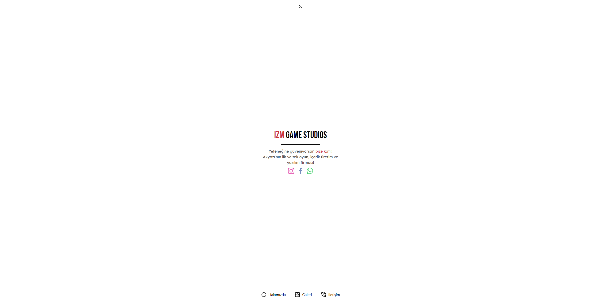

## IZM Game Studios

    <a href="/images/demo-dark.png"><small>- Karanlık Tema -</small></a>

> 🛠 Bu site, [@eggsydev](https://github.com/eggsydev) tarafından geliştirilmekte ve yönetilmektedir.

IZM Game Studios için geliştirilen internet sitesinin tüm kaynak kodları, kullanması ve düzenlemesi tamamen serbest. Sitenin önizlemesini görmek için [buraya](https://izmgamestudios.com) tıklayabilir, kodlarına bu sayfadan ulaşabilir ve indirebilirsiniz.

### 📩 Yükleme

Sitenin kodlarını derleyebilmek için öncelikle bilgisayarınıza [Node.js](https://nodejs.org/tr/)'in yüklü olduğundan emin olun. Daha sonra NPM (Node.js'in içinde gelir) veya [Yarn](https://yarnpkg.com) paket yöneticilerinden birini seçin (Yarn, NPM'e göre daha hızlı ve daha performanslı bir şekilde çalışabilir, bizim önerimiz bu yöndedir).

- Bu depoyu bilgisayarınıza klonlayın veya arşiv olarak indirin.
  - Bunu yukarıdaki indir butonuyla veya şu komutla yapabilirsiniz: `git clone https://github.com/IZM-Projects/izm-website`
- İndirdiğiniz klasörün içerisinde bir terminal penceresi açın.
  - CMD, PowerShell veya kendi tercihiniz.
- Modülleri yükleyin.
  - Eğer `yarn` yüklüyse: `yarn` veya `yarn install`
  - Yüklü değil ise: `npm install`
  - Yükleme tamamlandıktan sonra siteyi çalıştırın.
  - Bunun için `yarn` var ise `yarn dev`, NPM ile ise `npm run dev` yazın.
  - Siteyi statik olarak dışa aktarıp başka platformlarda paylaşmak için `yarn generate` (veya `npm run generate`) komutunu kullanın ve `dist/` klasöründe oluşturulan dosyaları sunucu sağlayıcınıza yükleyin.

### 🧬 Sitede Kullanılan Teknolojiler

Bu site [Vue](https://vuejs.org) ve onun geliştirilmiş hâli olan [Nuxt](https://nuxtjs.org) ile yapılmıştır. Sitenin çalıştırılabilmesi ve tarayıcı tarafından okunabilir hâle gelebilmesi için öncelikle yukarıdaki işlemlerden geçerek derlenmesi gerekir. Bunların yanında sitenin görüntüsü için [Buefy](https://buefy.org) kullanılmış, cihaz tespit etme için [@nuxtjs/device](https://github.com/nuxt-community/device-module) modülü, çevrimdışı kullanma ve cihaza uygulama olarak eklenebilme özelliği için [@nuxtjs/pwa](https://github.com/nuxt-community/pwa-module), karanlık ve aydınlık tema geçişleri için [@nuxtjs/color-mode](https://github.com/nuxt-community/color-mode-module), simgeler için ise [@iconscout/vue-unicons](https://npmjs.com/package/@iconscout/vue-unicons) kullanılmıştır.

Bu teknolojileri öğrenmek ileride işinize yarayabilir ve çalışmalarınızı önemli derecede hızlandırabilir. Bu kodları kendinize bir örnek ve kaynak olarak kullanın, lisans gereksinimlerine dikkat edin ve kodları istediğiniz gibi paylaşın.

### 🙏 Katkıda Bulunma

Sitenin geliştirilmesinde destek olmak için sitedeki hataları bildirebilir, özellik isteklerinizi gönderebilir veya direkt koda müdahale ederek "pull request" gönderip kodunuzu incelememizi sağlayabilirsiniz. Daha fazlası için [aramıza katılmayı da unutma](https://izmgamestudios.com/iletisim)!
